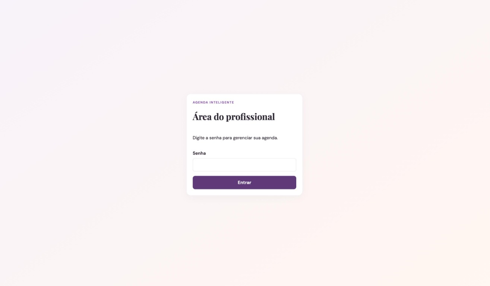
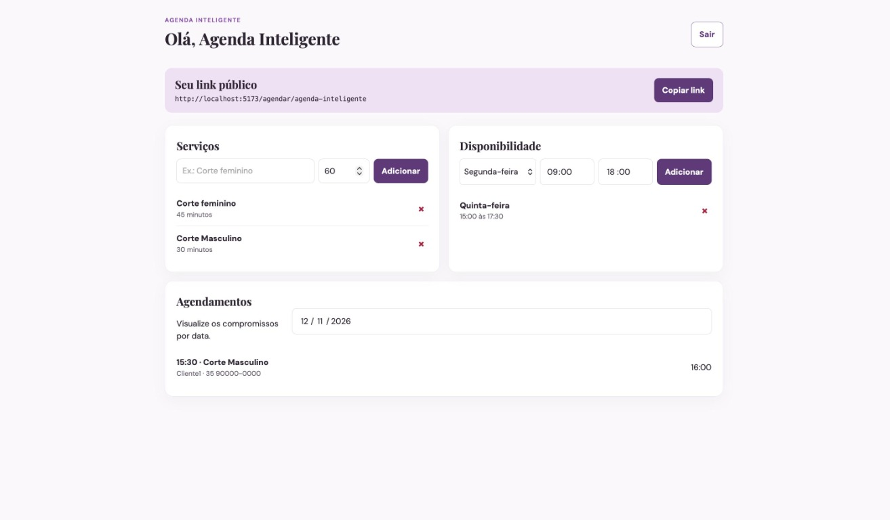
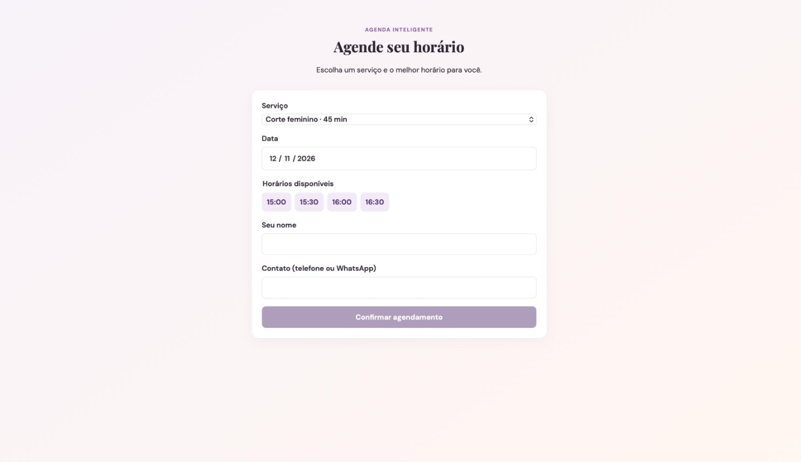
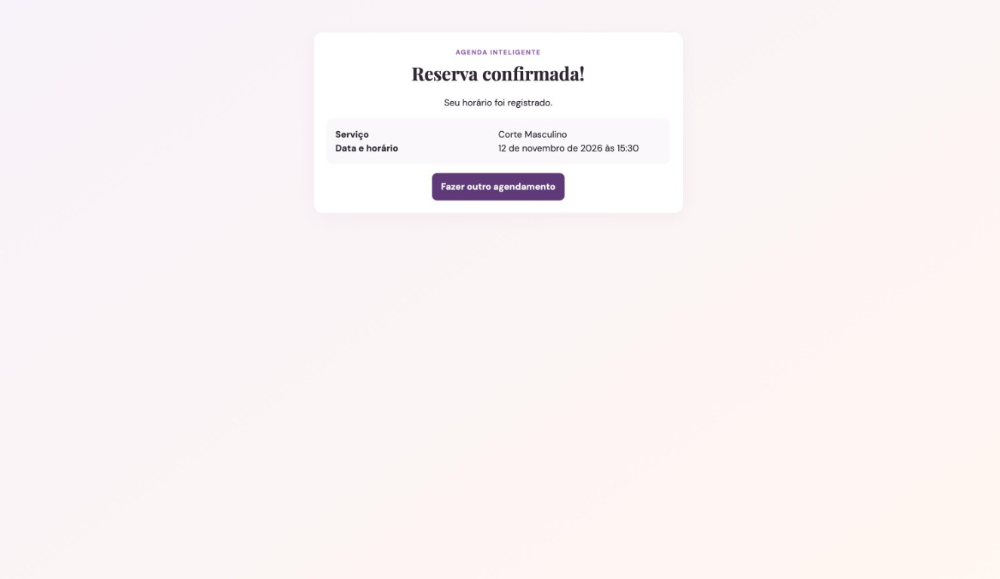

# Entrega 04 — MVP Funcional e Validação da Solução

Disciplina: Empreendedorismo em Sistemas de Informação
Semestre: 2026/2
Data de verificação: 10/11/2026
Empreendimento: Agenda Inteligente

## 1. Identificação do projeto

| Integrante |
|---|
| Bruno Santos Vilas Boas |
| Carolina Costa Ude |
| Christian Silva Mesquita |
| Matheus Levi Tavares |
| Thiago Vinícius Tristão Rojas |

**Repositório:** https://github.com/thiagovtr/softwareESI

## 2. Objetivo da Entrega 4

Apresentar o MVP funcional, documentar sua execução local e relacionar a solução às necessidades identificadas na Entrega 2. A hipótese da solução é que o profissional consiga configurar serviços e horários e compartilhar um link pelo qual o cliente consulta a disponibilidade e solicita um agendamento.

## 3. Descrição do MVP

A Agenda Inteligente é uma aplicação web para profissionais de beleza. O profissional acessa uma área administrativa protegida por senha, cadastra serviços e faixas de disponibilidade e compartilha um link público. O cliente acessa o link sem criar conta, escolhe serviço, data e horário, informa nome e contato e recebe a confirmação da reserva.

### 3.1. Funcionalidades implementadas no código

| Área | Funcionalidade identificada |
|---|---|
| Profissional | Autenticação HTTP Basic; consulta do perfil; cadastro e exclusão lógica de serviços; cadastro e exclusão de disponibilidades; consulta de agendamentos por data; cópia do link público. |
| Cliente | Acesso público por slug; consulta de serviços; seleção de data; consulta de horários livres; preenchimento de nome e telefone/WhatsApp; solicitação de agendamento; confirmação da reserva. |
| Regras | Duração de serviço entre 15 e 480 minutos; horários em intervalos de 30 minutos; verificação da disponibilidade; revalidação na gravação; rejeição de sobreposição; fuso `America/Sao_Paulo`; validação de campos obrigatórios. |

### 3.2. Funcionalidades fora do MVP

Não fazem parte desta versão: pagamentos online, integração automática com a API do WhatsApp, aplicativo nativo, gestão financeira, estoque, comissões, lista de espera, lembretes automáticos, histórico avançado de clientes e gestão de múltiplos profissionais.

## 4. Tecnologias utilizadas

| Camada | Tecnologia e versão/configuração |
|---|---|
| Backend | Java 27, Spring Boot 4.1.2, Spring Web MVC, Spring Data JPA, Spring Security e Bean Validation |
| Frontend | React 19.3.1, React DOM 19.3.1, Vite 8.3.6 e CSS |
| Banco de dados | PostgreSQL 18 via Docker Compose |
| Comunicação | API REST |
| Controle de versão | Git e GitHub |
| Ambiente verificado | Node.js v26.13.0, npm 11.20.0, Java 27.0.1; Maven Wrapper usando JDK 26.0.2 em `JAVA_HOME` |

## 5. Execução local

### 5.1. Requisitos

- Docker Desktop;
- JDK 27;
- Node.js 26.13.0 ou compatível;
- npm;
- acesso à internet na primeira execução do Maven Wrapper e na instalação das dependências.

### 5.2. Banco de dados

Na pasta `agenda-inteligente`:

```powershell
cd database
docker compose up -d
```

O PostgreSQL é exposto em `localhost:5432`, com banco `agenda_inteligente`, usuário `agenda` e senha `agenda`. Esses valores estão em `database/docker-compose.yml` e podem ser substituídos pelas variáveis de `backend/src/main/resources/application.yml`.

### 5.3. Backend

Em outro terminal:

```powershell
cd backend
.\mvnw.cmd spring-boot:run
```

A API utiliza a porta `8080`. O usuário padrão é `profissional` e a senha padrão é `agenda123`. Eles podem ser substituídos por `USUARIO_PROFISSIONAL` e `SENHA_PROFISSIONAL`.

### 5.4. Frontend

Em outro terminal:

```powershell
cd frontend
npm install
npm run dev
```

O frontend utiliza `http://localhost:5173`. A página pública padrão é `http://localhost:5173/agendar/agenda-inteligente`. É necessário cadastrar um serviço e uma disponibilidade antes de consultar horários.

### 5.5. Rotas principais

| Finalidade | Método e rota |
|---|---|
| Perfil do profissional | `GET /api/profissional/perfil` |
| Listar/criar serviços | `GET/POST /api/profissional/servicos` |
| Excluir serviço | `DELETE /api/profissional/servicos/{id}` |
| Listar/criar disponibilidades | `GET/POST /api/profissional/disponibilidades` |
| Excluir disponibilidade | `DELETE /api/profissional/disponibilidades/{id}` |
| Consultar agenda | `GET /api/profissional/agendamentos?data=AAAA-MM-DD` |
| Página pública | `GET /api/publico/{slug}` |
| Horários livres | `GET /api/publico/{slug}/horarios?servicoId={id}&data=AAAA-MM-DD` |
| Criar agendamento | `POST /api/publico/{slug}/agendamentos` |

## 6. Link do sistema

Não há versão hospedada identificada no repositório. A execução é local, com frontend em `http://localhost:5173` e API em `http://localhost:8080`.

## 7. Fluxo principal

1. O profissional informa a senha de acesso.
2. Cadastra um serviço e sua duração.
3. Cadastra uma faixa de disponibilidade.
4. Copia o link público.
5. O cliente escolhe serviço, data e horário livre.
6. O cliente informa nome e contato.
7. A API revalida a disponibilidade, considera a duração do serviço e grava a reserva no PostgreSQL.
8. A página pública apresenta a confirmação.
9. O profissional consulta o agendamento na agenda da data.
10. Uma tentativa sobreposta deve ser rejeitada pela regra de negócio e pela restrição do banco.

As etapas acima representam o funcionamento previsto do sistema com frontend, API e PostgreSQL integrados. Nesta revisão, o fluxo completo não foi validado em execução integrada porque o backend não foi compilado corretamente no ambiente utilizado. Assim, a implementação identificada no código deve ser distinguida das etapas efetivamente verificadas: houve verificação da interface frontend e inspeção das regras, mas não houve confirmação integrada de persistência, processamento da API ou rejeição de conflitos em execução.

## 8. Capturas de tela e evidências

As cinco imagens existentes em `docs/evidencias/prints/` documentam telas do frontend.


**Figura 1 —** Tela de entrada da área profissional.


**Figura 2 —** Painel com link público, serviços, disponibilidade e agenda vazia.


**Figura 3 —** Agenda com serviço, horário, nome e contato do cliente.


**Figura 4 —** Página pública de escolha de serviço, data, horário e dados do cliente.


**Figura 5 —** Confirmação apresentada após a reserva.

## 9. Validação do MVP e Resultados de Usabilidade

### 9.1. Validação técnica

| Verificação | Resultado | Evidência |
|---|---|---|
| Inspeção das funcionalidades e rotas | Confirmada no código | Controladores, `ServicoAgenda` e componentes React |
| Existência das capturas | Aprovada: 5 arquivos | `docs/evidencias/prints/` |
| Build do frontend com `npx vite build` | Aprovado | Vite gerou `dist/` e os assets |
| Lint do frontend com `npm run lint` | Falhou | Quatro erros de variáveis não utilizadas em `App.jsx` e `main.jsx` |
| Compilação limpa do backend | Falhou no ambiente | Maven usou JDK 26.0.2, mas o projeto exige `release 27` |
| Testes do backend com `.\mvnw.cmd test` | Falharam no ambiente | Incompatibilidade entre classes compiladas e a JVM usada pelo Surefire |
| Execução integrada com banco e API | Não concluída | O backend não compilou no ambiente utilizado |

### 9.2. Sessões de validação da interface

Devido ao bloqueio técnico na execução integrada local do backend, foram realizadas cinco sessões focadas exclusivamente na navegação, compreensão das telas e interação com os fluxos apresentados no frontend. A interface foi utilizada com dados simulados na tela. Essas sessões não validaram persistência no PostgreSQL, processamento real pela API ou regras de negócio em execução integrada; os resultados referem-se à experiência de utilização da interface.

Três sessões envolveram perfis profissionais e duas envolveram perfis de cliente final:

1. **Sessão 1 — Perfil profissional autônomo:**
   - Tarefa: Cadastrar um serviço e copiar o link público.
   - Resultado: Achou o painel de cadastro rápido e limpo, sem formulários longos.
2. **Sessão 2 — Perfil de proprietária de salão:**
   - Tarefa: Visualizar horários preenchidos na agenda do dia.
   - Resultado: Conseguiu realizar a leitura, mas sugeriu que a visualização fosse destacada por cores dependendo do tipo de serviço.
3. **Sessão 3 — Perfil profissional autônomo:**
   - Tarefa: Configurar faixa de disponibilidade.
   - Resultado: Entendeu a lógica de "faixa de horários", mas relatou dúvida inicial no formato numérico das horas.
4. **Sessão 4 — Perfil de cliente final:**
   - Tarefa: Simular uma reserva acessando o link, escolhendo serviço e horário.
   - Resultado: O usuário avançou sem atritos; mencionou que achou excelente não ter que criar uma senha ou preencher e-mail.
5. **Sessão 5 — Perfil de cliente final:**
   - Tarefa: Avançar a reserva sem inserir o telefone.
   - Resultado: A aplicação retornou o aviso visual esperado; após isso, a tarefa foi concluída facilmente.

### 9.3. Resultados e Validação da Solução

Com base nas cinco sessões de interface descritas na Seção 9.2:

* **Navegação do painel profissional:** as sessões 1, 2 e 3 indicaram compreensão inicial do cadastro de serviço, da leitura da agenda e da configuração de faixa de disponibilidade. A dúvida sobre o formato das horas e a sugestão de diferenciar serviços por cores apontam oportunidades de melhoria de orientação e apresentação.
* **Facilidade de solicitar agendamento:** na sessão 4, o participante de perfil cliente final avançou pelo fluxo de escolha de serviço e horário sem relatar atrito e valorizou não precisar criar senha ou informar e-mail. Esse resultado indica uma percepção positiva nessa sessão, mas não comprova a eliminação do problema de instalação de aplicativos nem pode ser generalizado para todos os clientes.
* **Validação de dados obrigatórios:** na sessão 5, a interface apresentou um aviso ao tentar avançar sem telefone e permitiu a continuidade após o preenchimento. Isso indica que a interação visual de validação foi compreendida nessa sessão; não comprova a validação correspondente no backend.
* **Link público:** a sessão 1 incluiu a tarefa de copiar o link público e registrou percepção positiva sobre o painel. Esse resultado documenta a interação de um participante com essa funcionalidade, não uma confirmação geral de sua utilidade por todos os profissionais.
* **Limitação técnica:** as sessões não verificaram persistência, processamento da API, cálculo real de horários ou rejeição de conflitos. Essas verificações dependem da conclusão da execução integrada.

### 9.4. Análise Qualitativa Consolidada do MVP

Os testes indicaram boa aceitação inicial da interface nas tarefas observadas. Os participantes demonstraram facilidade em determinadas etapas, especialmente na leitura do painel, na escolha de serviço e horário e na interação com a validação visual de campos. Também surgiram dúvidas e sugestões concretas sobre o formato das horas e a diferenciação visual dos serviços.

As entrevistas anteriores ajudam a explicar esses resultados: P1, P3, P6 e P8 relataram preferência por soluções simples, acessíveis pelo celular e sem cadastro complexo; P2, P4, P5 e P7 relataram problemas relacionados à atualização manual, à comunicação por diferentes canais e aos conflitos de agenda. A interface implementada aborda parte dessas necessidades por meio do painel, do link público e do fluxo sem conta para o cliente.

Esses resultados não comprovam que o MVP eliminou o uso do WhatsApp, que é superior a aplicativos existentes ou que garantirá adesão do público. Eles sugerem que a proposta possui potencial para atender às necessidades identificadas, mas a validação do funcionamento integrado ainda depende da conclusão dos testes técnicos e de uma avaliação posterior com o sistema conectado ao backend.

## 10. Problemas e Limitações identificados

### 10.1. Problemas técnicos

* **Problema de lint no frontend:** foram identificados quatro erros relacionados a variáveis não utilizadas nos arquivos `App.jsx` e `main.jsx`.
* **Problema de compilação do backend:** o projeto exige Java 27, mas o Maven Wrapper utilizou o JDK 26.0.2 configurado em `JAVA_HOME`. Essa divergência provocou incompatibilidade na compilação.
* **Problema nos testes automatizados:** o Surefire apresentou incompatibilidade entre as classes compiladas e a JVM utilizada.
* **Limitação da execução integrada:** como o backend não compilou corretamente no ambiente utilizado, não foi possível concluir a execução integrada entre frontend, API e PostgreSQL. Portanto, as regras de negócio que dependem dessa integração não foram comprovadas por execução completa.

### 10.2. Limitações de usabilidade
* O painel não possui tutorial ou explicação contextual para orientar o cadastro de disponibilidade inicial do profissional.
* O fluxo do cliente não possui uma etapa de "resumo de revisão" antes da confirmação final.
* O compartilhamento do link é manual e não há integração de mensagens.

### 10.3. Limitações funcionais
* O seed inicial atende apenas a um único profissional (`agenda-inteligente`).
* Não há funcionalidades de cancelamento, lista de espera, ou suporte a equipes do salão.

## 11. Modificações e melhorias futuras

*   **Corrigir ambiente de desenvolvimento:** Padronizar as configurações de variáveis de ambiente do Maven para utilizar exclusivamente o JDK 27.
*   **Correção de código frontend:** Limpar variáveis ociosas apontadas pelo linter no React.
*   **Expansão:** Executar o fluxo integrado real e validar conflitos de banco de dados diretamente; adicionar orientação de uso ao painel.
*   **Novas Features:** Implementar cancelamento, remarcação, lembretes, lista de espera e avaliar suporte a múltiplos profissionais.

## 12. Declaração de uso de ferramentas de inteligência artificial

Durante o desenvolvimento do projeto Agenda Inteligente, a equipe utilizou ferramentas de inteligência artificial como apoio ao desenvolvimento do código-fonte, auxiliando no processo de implementação e elaboração de trechos de código. As sugestões foram avaliadas e adaptadas pela equipe conforme as necessidades do projeto. A equipe permaneceu responsável pelas decisões de desenvolvimento, integração e avaliação do sistema.